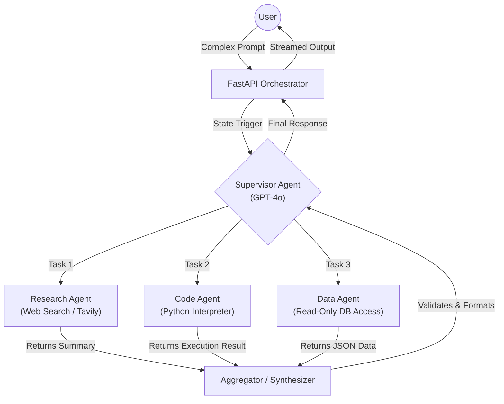

# Blueprint: Multi-Agent Orchestration

Multi-Agent Orchestration utilizes a "Router" or "Supervisor" agent to interpret complex user intents, dynamically delegate tasks to specialized worker agents, and aggregate their findings into a single cohesive response.

## 🏗️ Architecture Diagram

## 💰 Cost Analysis at Scale
*Assuming 10,000 MAU (Monthly Active Users) averaging 20 complex queries/day.*

* **Supervisor Agent (Heavy Reasoning):** GPT-4o or Claude 3.5 Sonnet. Requires high intelligence for accurate routing and aggregation. Cost: **~$500-$800/month** (due to passing the entire conversation history back and forth).
* **Worker Agents (Task Specific):** GPT-4o-mini, Claude 3 Haiku, or local Llama 3 8B. Cost: **~$150-$300/month**.
* **External Tooling APIs:** Web search APIs (Tavily/Serper) and sandboxed cloud compute environments (E2B). Cost: **~$100/month**.

## ⏱️ Latency Bottlenecks & Mitigations

1. **Sequential Agent Loops (5s - 15s+):**
   * *Mitigation:* The Supervisor agent must be instructed to dispatch tasks in parallel (using `asyncio.gather` in Python or LangGraph's parallel edge routing) whenever worker agents do not depend on each other's outputs.
2. **Silent Thinking Time (User Drop-off):**
   * *Mitigation:* Stream the internal "thought process" and tool calls to the frontend UI (e.g., UI displays: *"Agent is searching the web..."*, *"Agent is running code..."*). This keeps the user engaged while waiting for the final response.

## 🛡️ Security Guardrails & Enterprise Compliance

* **Principle of Least Privilege (PoLP) per Agent:** Never give the main orchestration loop global tool access. The Data Agent must use database credentials with strictly `SELECT` permissions. The Code Agent must execute inside an ephemeral, network-isolated Docker container (e.g., E2B or local gVisor).
* **Blast Radius Containment:** If a worker agent falls victim to a prompt injection attack via untrusted web search data, its output must be sanitized by the Aggregator node before being returned, preventing privilege escalation.
* **Infinite Loop Prevention:** Implement a strict `max_loops` or `recursion_limit` parameter in your state graph architecture to prevent agents from getting stuck in conversational loops that drain API credits and crash backend servers.