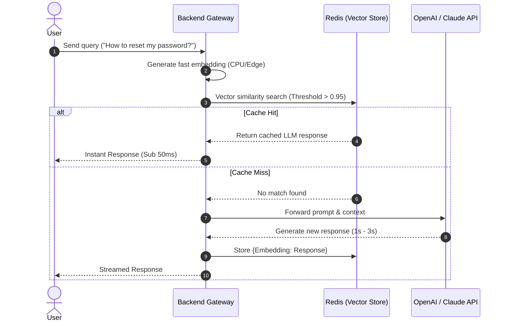

# Blueprint: Semantic Caching

Semantic Caching sits in front of your LLM calls. Instead of caching exact string matches (which rarely happen in natural language), it caches the vector embeddings of previous questions. If a new user asks a question with a 95%+ semantic similarity to a previous one, it returns the cached answer instantly, bypassing the expensive LLM API call.

## 🏗️ Architecture Diagram

## 💰 Cost Analysis at Scale
*Assuming 100,000 queries/month on a B2C customer support bot.*

* **Without Caching:** 100,000 calls to GPT-4o averaging $0.02 per call = **$2,000/month**.
* **With 40% Cache Hit Rate:** 
  * 60,000 calls to GPT-4o = **$1,200/month**.
  * Redis with Vector Search enabled (e.g., Redis Cloud or Upstash) = **~$30-$70/month**.
  * Local embedding compute = **$0**.
  * **Total Savings:** **~$730/month**.

## ⏱️ Latency Bottlenecks & Mitigations

1. **Embedding Generation Overhead:**
   * *Mitigation:* Do not use a heavy/slow embedding model or an external API (like OpenAI's `text-embedding-3-small`) to generate the cache lookup vector. This adds network latency. Use a tiny, sub-100MB model like `all-MiniLM-L6-v2` running natively on your server's CPU or edge functions.
2. **False Positives (Stale/Incorrect Hits):**
   * *Mitigation:* Set a strict high similarity threshold (e.g., `0.95` or `0.98`) and implement a Time-To-Live (TTL) eviction policy so the cache clears itself every 24-48 hours.

## 🛡️ Security Guardrails & Enterprise Compliance

* **Multi-Tenant Data Leakage:** If you are building a B2B SaaS, User A must never hit a cache generated by User B's private data. 
  * *Fix:* Append a `tenant_id` or `workspace_id` to the cache key payload. The semantic search must enforce a hard metadata filter on the `tenant_id` before evaluating vector similarity.
* **PII Redaction:** Cache storage is often less secure than the primary database. Ensure any Personal Identifiable Information (PII) is masked using a library like Microsoft Presidio before the response is committed to the cache.

## 💻 Implementation Example
Want to see this in code? Check out our [Python FastAPI implementation](../code-examples/semantic_cache.py) using Redis and `sentence-transformers`.