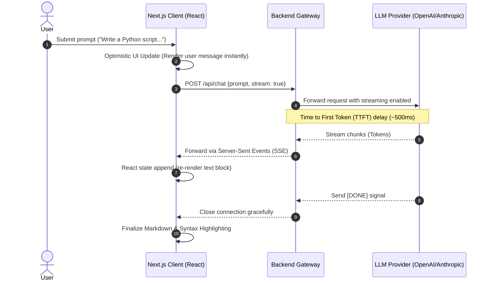

# Blueprint: Streaming UI & Server-Sent Events (SSE)

In traditional web apps, the frontend waits for the backend to finish processing before rendering the response. In AI-native apps, the backend streams the response token-by-token using Server-Sent Events (SSE) so the frontend can render the answer in real-time, drastically reducing perceived latency.

## 🏗️ Architecture Diagram

## 💰 Cost Analysis & Infrastructure Scaling
*Assuming heavy concurrent traffic.*

* **Serverless Functions vs. Long-Lived Servers:** 
  * Vercel/AWS Lambda serverless functions often have a 10-second to 60-second execution timeout. If an LLM takes 2 minutes to stream a massive code block, a serverless function will timeout and kill the stream. 
  * *Cost Impact:* You may need to migrate the streaming gateway from cheap Serverless Edge functions to provisioned containers (AWS ECS / Google Cloud Run) which cost **~$20-$50/month per container instance**.

## ⏱️ Latency Bottlenecks & Mitigations

1. **Frontend Re-render Thrashing:**
   * *Bottleneck:* If the LLM sends 50 tokens per second, updating the React state 50 times per second will freeze the browser's main thread and make the page unresponsive.
   * *Mitigation:* Throttle/debounce the UI updates, or use specialized hooks like `useChat` from the Vercel AI SDK which handles stream buffering efficiently under the hood.
2. **Markdown Parsing Overhead:**
   * *Bottleneck:* Re-parsing the entire accumulated string into Markdown (using `react-markdown`) on every single token update is computationally expensive.
   * *Mitigation:* Memoize the rendered markdown components and only parse the active, changing block rather than the entire conversation history.

## 🛡️ Security Guardrails & Enterprise Compliance

* **Cross-Site Scripting (XSS) via Markdown:** LLMs can be manipulated into generating malicious JavaScript inside standard Markdown links or image tags. You must heavily sanitize the streamed output on the frontend using libraries like `DOMPurify` before rendering it into the DOM.
* **Denial of Service (DoS) via Connection Exhaustion:** SSE keeps HTTP connections open for a long time. Malicious users can open thousands of simultaneous chat streams to exhaust your backend's connection pool. Implement strict IP-based rate limiting on your `/api/chat` streaming endpoint.